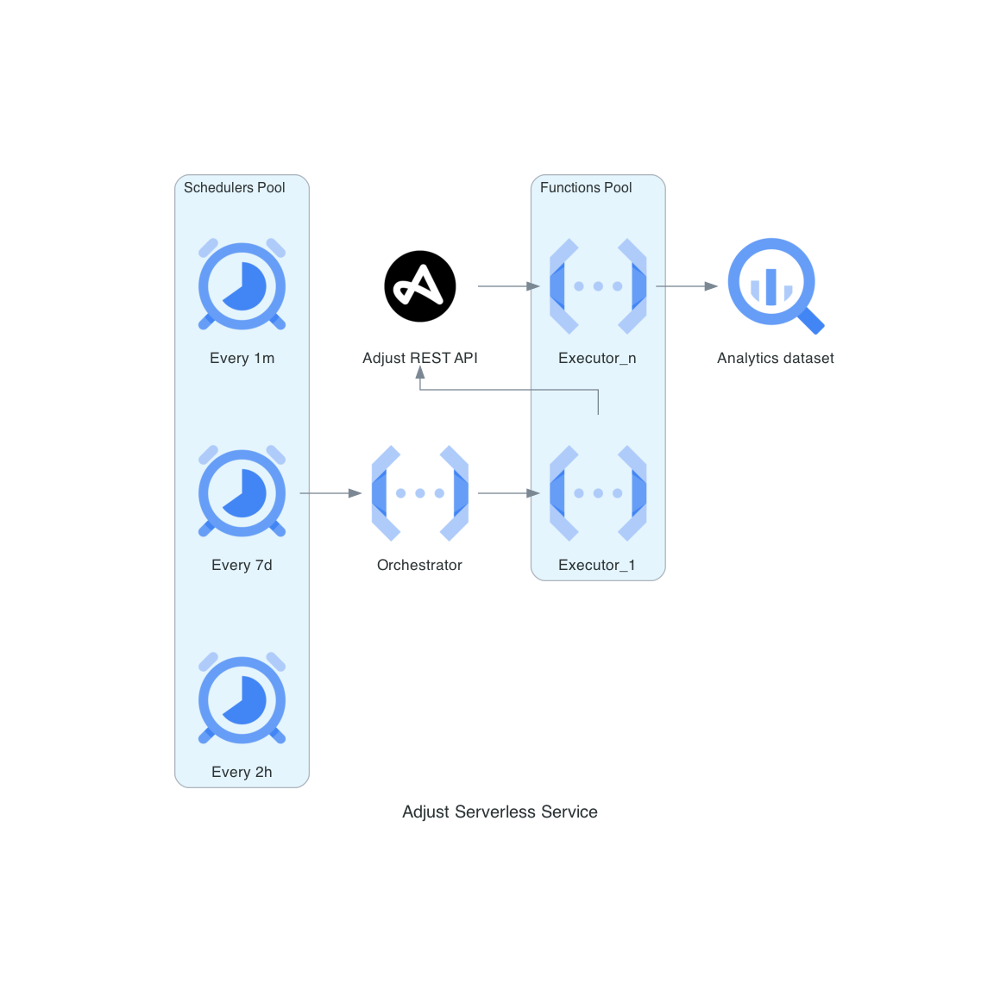

# Adjust Report API Function

[](https://github.com/Gasta88/fake_adjust_serverless_service/actions/workflows/cicd.yaml)

## Purpose/Goals

The *Fake Adjust Serverless Service* queries the Fake Adjust REST API and loads the
attribution reporting data into BigQuery.

The project collects Fake Adjust Report API data at different intervals:

- every 2h
- every week
- every month

This is done because Fake Adjust simulates a data aggregator itself and the velocity
of different sources is quite different from each other. Without any warning, some
records could be updated, so it is necessary to keep the most recent view of the data.

The retrieved data is later recorded in BigQuery and sanitised via an ELT process.

## Pipeline context

This repository is **stage 2** of a three-stage story:

1. **[fake_adjust](https://github.com/Gasta88/fake_adjust)** — a small FastAPI service
   that serves synthetic Adjust-style reports. It is deployed separately and is not
   vendored here.
2. **fake_adjust_serverless_service** (this repo) — schedules calls to that API,
   downloads the reports and loads them into BigQuery.
3. **Dataform** — builds the materialised views on top of the BigQuery tables
   (out of scope for this repository).

## Infrastructure design



## Data workflow

- At a fixed interval, a scheduler sends an HTTP call to the *orchestrator* Cloud Function.
- According to the schedule, it builds the right type and the right amount of URLs (5, 14 or 30).
- In a "fire-and-forget" fashion, it sends each URL to the *executor* Cloud Function.
- Each URL creates an isolated instance of the *executor* Cloud Function.
- Destination BigQuery dataset and tables are fetched and two consecutive HTTP POSTs are
  made to the Fake Adjust Report API:
    - one for *ios* platform
    - one for *android* platform
- The returned data is manipulated in Pandas according to the BigQuery table specifics.
- The operation day and timestamp are recorded inside the dedicated lookup table used to
  build the materialised view via Dataform at a later stage (out of this repository scope).

## Data observability

Both functions emit structured JSON logs to stdout via `write_log` (`severity`,
`message`, `custom_property`). Cloud Logging indexes them automatically, so every
execution can be filtered by severity, scheduler id, platform and report day. There is
no custom metrics or dashboard provisioning in this repository.

## Deployment

The production deploy runs on every push to `main` and can also be triggered manually
(`workflow_dispatch`). It runs only after the Terraform and Python test jobs pass, then:

1. Creates the BigQuery tables if they do not exist (idempotent).
2. Runs `terraform apply` in the `prod` workspace.

Configuration is exposed as Terraform variables in `deploy/variables.tf`:

| Variable | Default | Purpose |
| --- | --- | --- |
| `project_id` | `eighth-duality-457819-r4` | GCP project for functions, schedulers and buckets |
| `region` | `us-central1` | Provider region |
| `service_account_email` | `874544665874-compute@developer.gserviceaccount.com` | OIDC identity used by Cloud Scheduler |
| `fass_api_url` | `https://fass-api-874544665874.us-central1.run.app/reporting` | Stage-1 API endpoint |
| `bq_project` | `bondola-ai` | Project that owns the production dataset |
| `bq_dataset` | `analytics` | Production dataset |

The BigQuery project and dataset used by CI can be overridden with the repository
variables `BQ_PROJECT` and `BQ_DATASET`.

### Required GitHub configuration

- Secret `SERVICE_ACCOUNT_KEY` — JSON key with access to the GCP project and the
  production BigQuery dataset.

## Testing the pipeline

Tests live in three places and run on every push in GitHub Actions:

- `test/unit_tests/` — asserts the shape of `terraform plan` output (buckets,
  schedulers, functions).
- `orchestrator_func/test/` — mocked unit tests for URL building, execution fan-out and
  the GCS lock check.
- `executor_func/test/` — mocked unit tests for data cleaning, GCS paths, BigQuery
  writes and the lookup-table update.

These are **unit tests with mocked GCP clients plus Terraform plan assertions**. They do
not call the Fake Adjust API, GCS or BigQuery, and they are not end-to-end tests.

## Local commands

```bash
make test            # run the Python unit tests
make plan ENV=dev    # terraform init + plan in the dev workspace
make deploy ENV=prod # terraform init + apply in the prod workspace
make docs            # regenerate the architecture diagram
```

## Repository layout

```
deploy/              Terraform: GCS bucket, Cloud Scheduler jobs, Cloud Functions
orchestrator_func/   HTTP function that fans out executor calls
executor_func/       HTTP function that downloads reports and loads BigQuery
docs/                Architecture diagram and its generator
test/                Terraform plan assertions
```
